<p align="center">
  
</p>

<h3 align="center">Professional kitchen equipment, sold the modern way.</h3>

<p align="center">
  A full-stack e-commerce platform built with <b>Django</b>, <b>Django REST Framework</b> and <b>React</b>:<br>
  reliable cart, account-gated checkout, multi-method payments and a custom design system.
</p>

<p align="center">
  
  
  
  
  
  
  <a href="LICENSE"></a>
  <a href="DISCLAIMER.md"></a>
</p>

<p align="center">
  
</p>

---

## Table of contents

- [Features](#features)
- [Screenshots](#screenshots)
- [Purchase flow](#purchase-flow)
- [Architecture](#architecture)
- [Tech stack](#tech-stack)
- [Getting started](#getting-started)
- [Payments (demo gateway)](#payments-demo-gateway)
- [API reference](#api-reference)
- [Project structure](#project-structure)
- [Design system and brand](#design-system-and-brand)
- [Roadmap](#roadmap)
- [Credits](#credits)
- [License and disclaimer](#license-and-disclaimer)

---

## Features

| Area | What you get |
|---|---|
| **Catalog** | Categories, filtering, sorting, stock badges, HD product photos |
| **Cart** | Works for guests and customers; guest carts are **merged into the account at login or sign-up**; stock checks on every add |
| **Checkout** | Account required to pay; guests are redirected to log in or sign up, then return to checkout with their cart intact |
| **Payments** | Card (Visa, Mastercard, American Express), PayPal, Google Pay, Apple Pay and crypto (BTC, ETH, USDT, USDC), with server-side validation |
| **Orders** | Atomic order creation, row locking against overselling, stock decrement, payment reference and confirmation page |
| **Two frontends** | Server-rendered Django templates **and** a React single-page app on the same REST API |
| **Design** | Custom logo and a shared design system (tokens, components) used by both frontends |
| **Quality** | Fully in English (UI, emails, admin), responsive, keyboard-accessible, reduced-motion aware |

---

## Screenshots

### Django storefront

| Shop | Product |
|---|---|
| 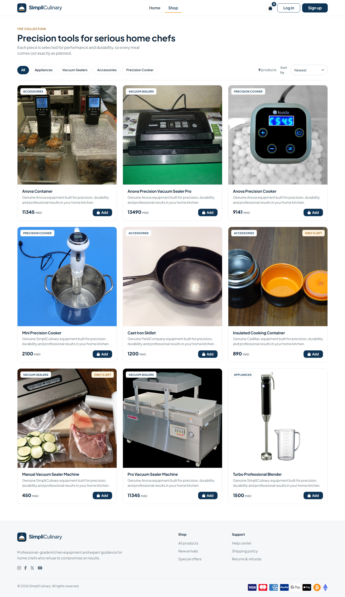 | 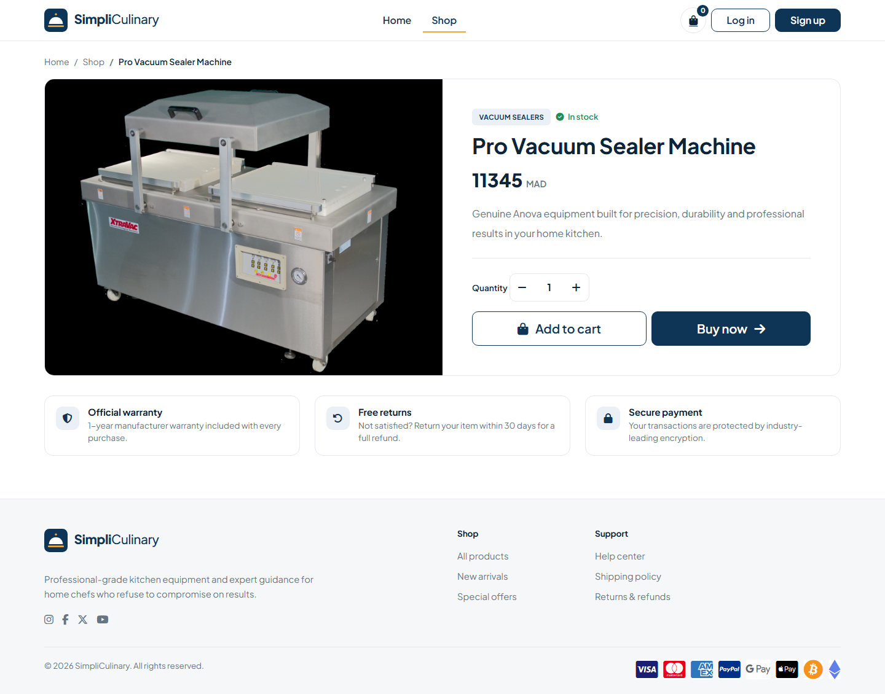 |

| Cart | Checkout |
|---|---|
| 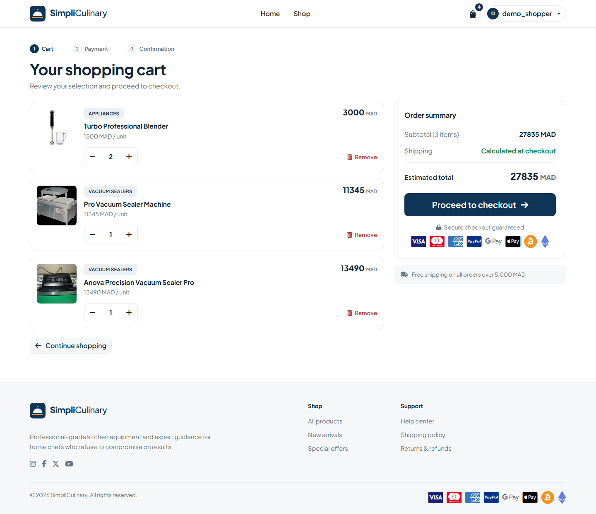 | 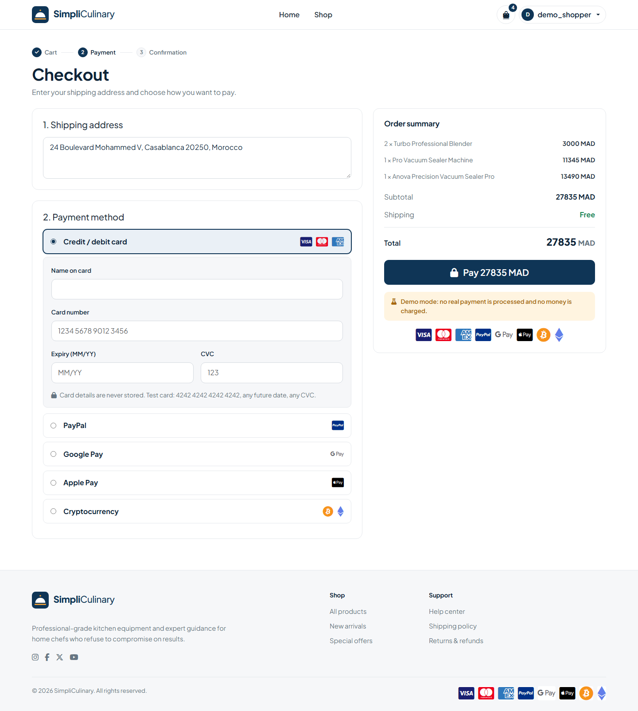 |

| Order confirmation | Sign up |
|---|---|
| 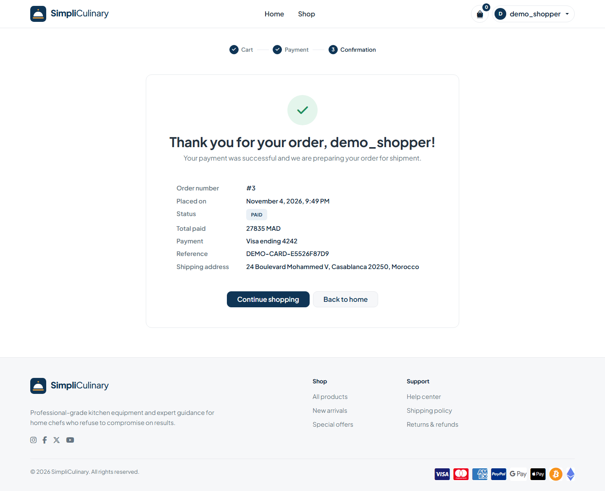 | 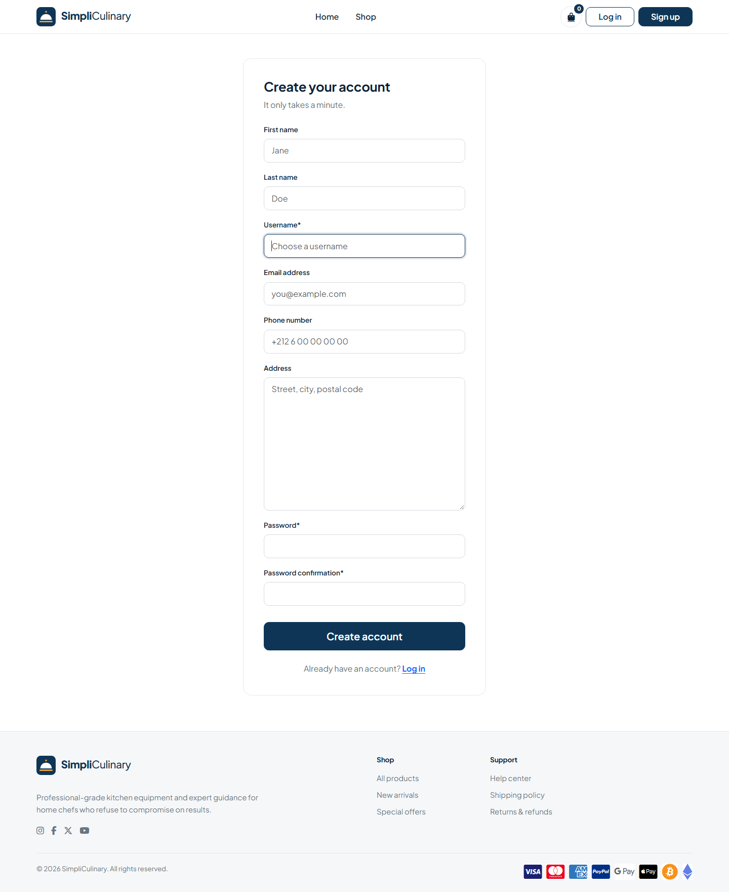 |

### React storefront

| Home | Shop | Product |
|---|---|---|
| 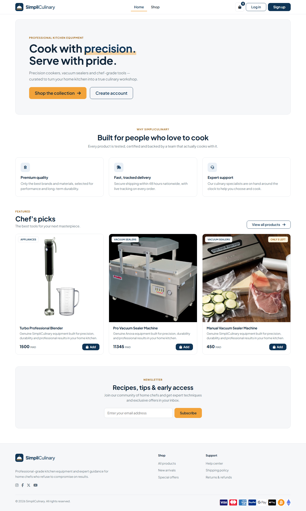 |  |  |

### Mobile

<p>
  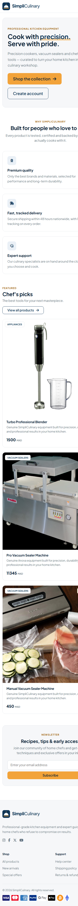
  &nbsp;&nbsp;
  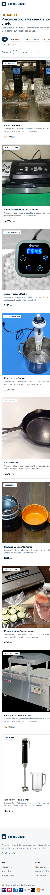
</p>

---

## Purchase flow

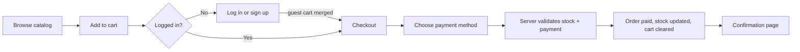

---

## Architecture

One backend, two interchangeable frontends.

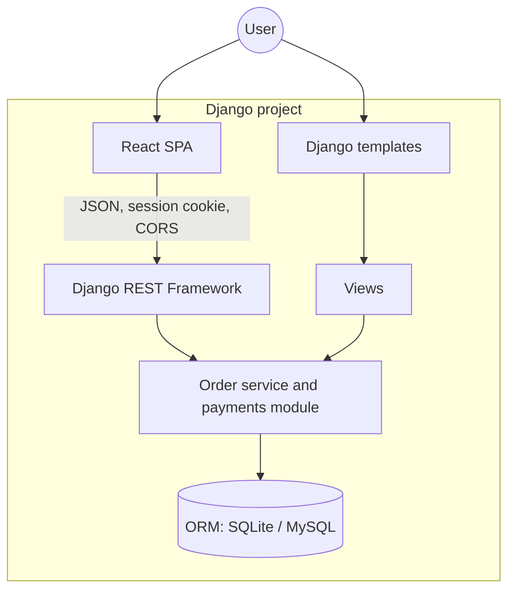

### Data model

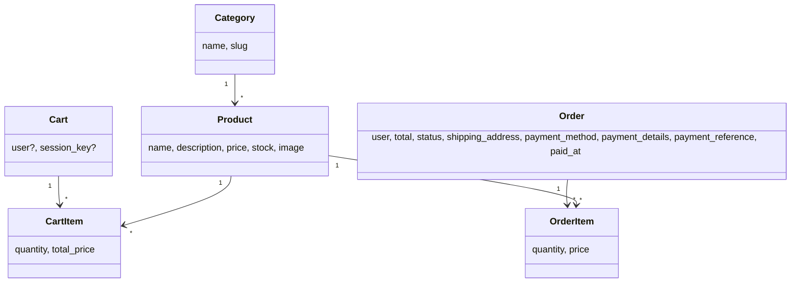

---

## Tech stack

| Layer | Technology |
|---|---|
| Backend | Python, Django, Django REST Framework, django-cors-headers, django-crispy-forms |
| Frontend (SPA) | React 19, React Router, React Bootstrap, Axios |
| Frontend (templates) | Django templates, Bootstrap 5.3, Font Awesome |
| Database | SQLite (development), MySQL-ready |
| Typography | Plus Jakarta Sans |

---

## Getting started

### 1. Clone

```bash
git clone https://github.com/Lagmouchyoussef/SimpliCulinary-Pro.git
cd SimpliCulinary-Pro
```

### 2. Backend (terminal 1)

```bash
cd backend
python -m venv venv
venv\Scripts\activate            # macOS / Linux: source venv/bin/activate
pip install -r requirements.txt
python manage.py migrate
python import_list.py            # loads 9 demo products with HD photos
python manage.py createsuperuser # optional: access to /admin
python manage.py runserver 8001
```

Open <http://127.0.0.1:8001> for the Django storefront.

### 3. React frontend (terminal 2)

```bash
cd frontend
npm install
npm start
```

Open <http://localhost:3000>. The API URL defaults to `http://127.0.0.1:8001` and can be changed with `REACT_APP_API_URL`.

---

## Payments (demo gateway)

> **No real money is ever charged.** `backend/orders/payments.py` is a demo gateway: it validates the data and simulates an authorisation. Card numbers, expiry dates and CVC codes are validated then discarded; only the card brand and last four digits are stored on the order.

| Test input | Result |
|---|---|
| Card `4242 4242 4242 4242`, any future date, any CVC | Accepted |
| Card `4000 0000 0000 0002` | Declined (demonstrates the failure path) |
| Invalid number, past expiry, wrong CVC length | Validation errors |
| PayPal, Google Pay, Apple Pay, crypto | Accepted in demo mode |

To go live, replace `process_payment` with a real integration (for example Stripe for cards, Apple Pay and Google Pay; PayPal; Coinbase Commerce for crypto).

---

## API reference

Base URL: `http://127.0.0.1:8001`. The React app authenticates with the Django session cookie (`withCredentials`).

| Method | Endpoint | Description | Auth |
|---|---|---|---|
| GET | `/products/api/` | List products | Public |
| GET | `/products/api/<id>/` | Product detail | Public |
| GET | `/cart/api/` | Current cart (guest or user) | Session |
| POST | `/cart/api/` | Add `{product_id, quantity}`, stock-checked | Session |
| DELETE | `/cart/api/item/<id>/` | Remove an item from your own cart | Session |
| POST | `/users/api/signup/` | Create an account and merge the guest cart | Public |
| POST | `/users/api/login/` | Log in and merge the guest cart | Public |
| POST | `/users/api/logout/` | Log out | Session |
| GET | `/users/api/session/` | `200` if logged in, `401` otherwise | Session |
| POST | `/orders/api/create/` | Pay and create the order (JSON only) | Login required |
| POST | `/api/newsletter/` | Subscribe an email | Public |

---

## Project structure

```text
SimpliCulinary-Pro/
├── backend/
│   ├── backend/            # settings, urls
│   ├── base/               # home page, base templates, newsletter, auth helper
│   ├── products/           # catalog (models, views, templates, API)
│   ├── cart/               # cart logic, guest-to-user merge
│   ├── orders/             # checkout, payments module, order service
│   ├── users/              # custom user, signup/login (HTML + API)
│   ├── sample_images/      # HD demo photos (+ CREDITS.md)
│   ├── static/base/        # theme.css, logo files, Bootstrap
│   └── import_list.py      # demo catalog importer
├── frontend/               # React SPA (src/screens, src/components, theme.css)
├── docs/
│   ├── screenshots/        # images used in this README
│   └── brand/              # logo files
└── linkedin/               # post text
```

---

## Design system and brand

- **Logo:** a chef's serving cloche on a deep-blue tile, with an amber accent. Files in [`docs/brand/`](docs/brand): `logo.svg`, `logo-light.svg` (dark backgrounds), `logo-mark.svg`, `logo-mark-512.png`.
- **Theme:** one stylesheet shared by both frontends: `backend/static/base/css/theme.css`, mirrored in `frontend/src/theme.css` (keep them in sync).
- **Palette:** Ink `#0F2438` · Navy `#0F3556` · Amber `#F2A33A` · Soft grey `#F6F7F9`
- **Principles:** simple, flat, generous whitespace, one typeface, accessible contrast and visible focus states.

---

## Roadmap

- [ ] Real payment provider integration (Stripe / PayPal / crypto processor)
- [ ] Order history and customer dashboard
- [ ] Automated test suite (cart merge, checkout, payment validation)
- [ ] Email receipts and order status updates
- [ ] Product search and reviews
- [ ] Docker setup and CI pipeline

---

## Credits

- Demo product photos come from Wikimedia Commons under Creative Commons licences; see [`backend/sample_images/CREDITS.md`](backend/sample_images/CREDITS.md). Replace them with official product images in production.
- Icons by [Font Awesome](https://fontawesome.com), typography by [Plus Jakarta Sans](https://fonts.google.com/specimen/Plus+Jakarta+Sans).

---

## License and disclaimer

This project is released under the [MIT License](LICENSE).

> **Demonstration project.** SimpliCulinary Pro was built for learning and portfolio purposes only. Payments are simulated and all products and customers are fictional.
>
> **Lawful use only.** If someone uses this project for anything illegal, fraudulent or harmful, they are solely responsible and may be pursued by the law. **The author is not responsible** for any misuse.
>
> Read the full [DISCLAIMER](DISCLAIMER.md).

---

<p align="center">
  Developed by <b>Lagmouch Youssef</b><br>
  If you find this project useful, please consider giving it a star.
</p>
